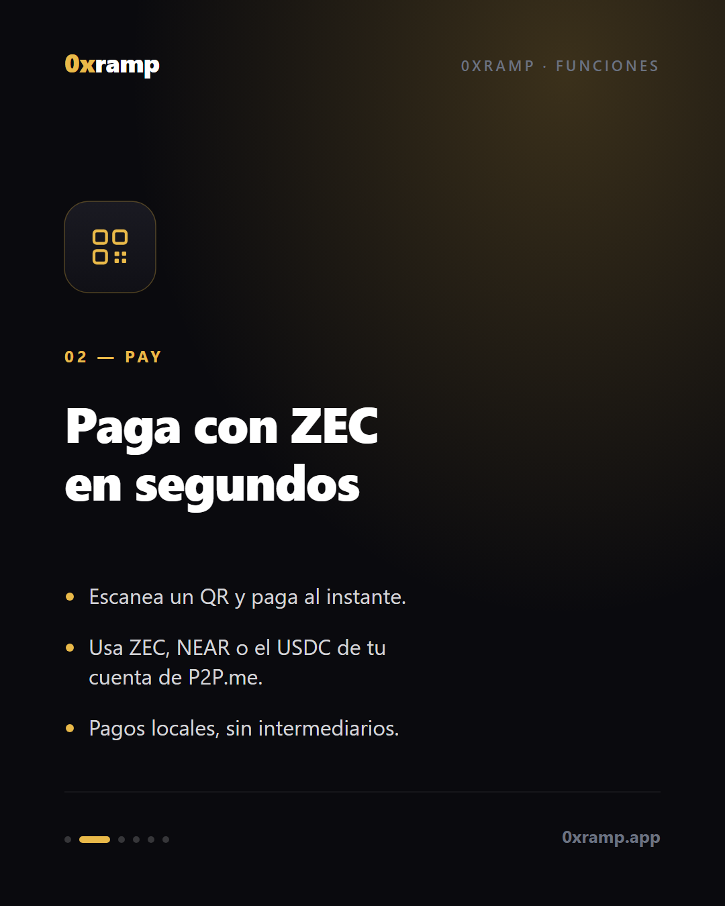
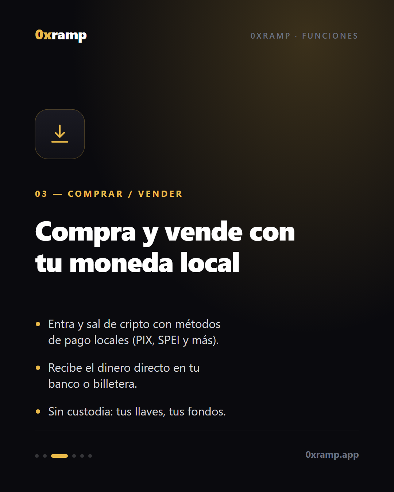
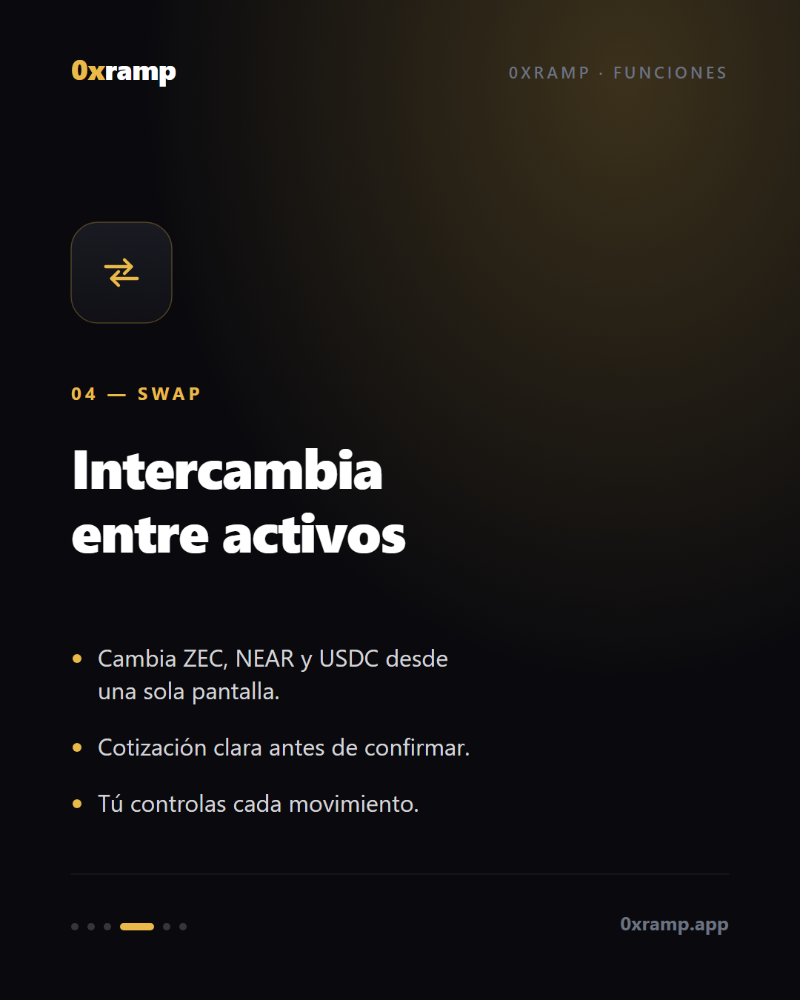
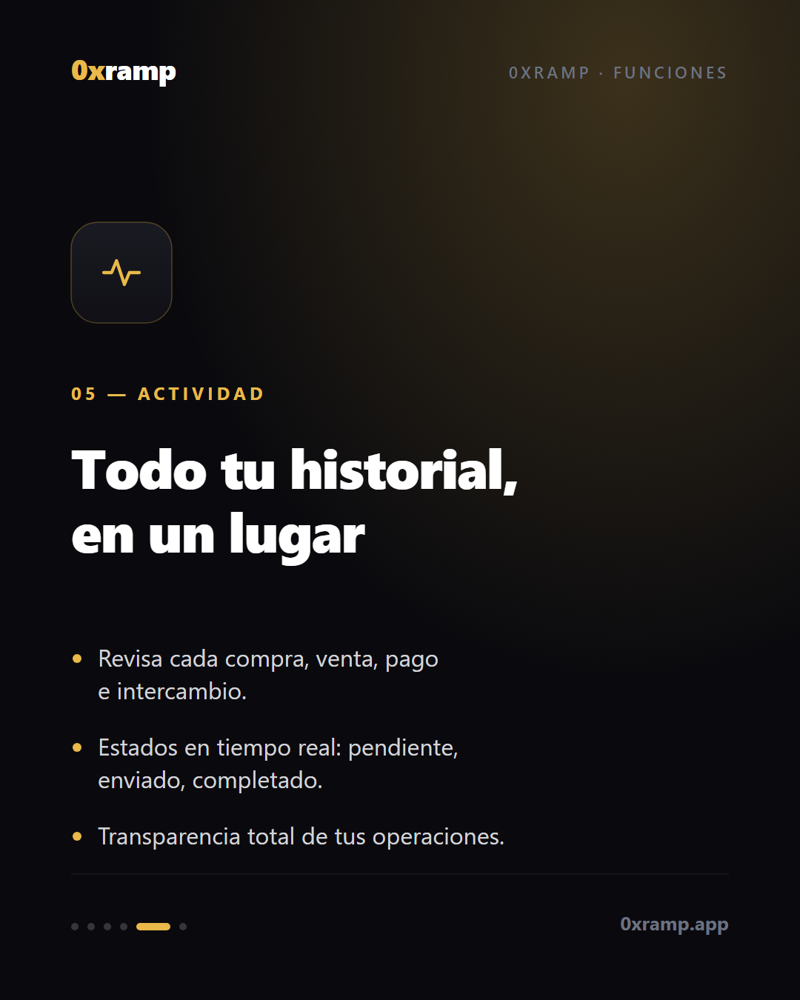
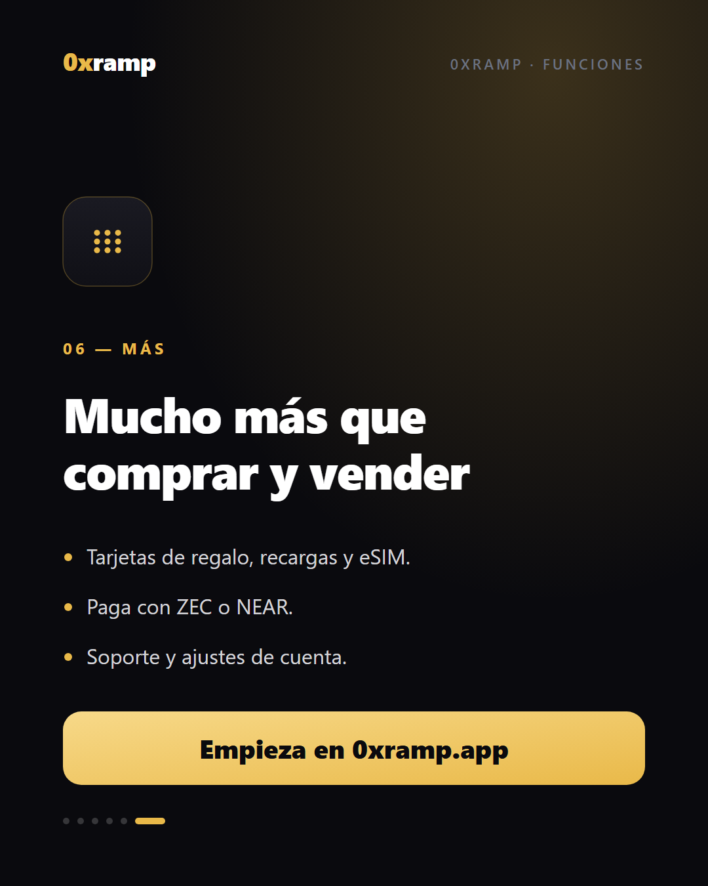

# Carrusel 0xramp — «Conoce las Funciones Principales de 0xramp»

Entregable para el bounty de ZecHub **Diseño de carrusel: Conoce las Funciones Principales de 0xramp**
(`cmwti5v0p00avcv2vjrbkcccq` · 35 USD en ZEC · equipo Zcash en Español).

6 imágenes · **1080 × 1350 px** (4:5, formato X/Twitter) · español · PNG finales + SVG editables.

---

## Las 6 imágenes

### 1 — Presentación de 0xramp


### 2 — Pay


### 3 — Comprar / Vender


### 4 — Swap


### 5 — Actividad


### 6 — Más


---

## Contenido del repositorio

| Ruta | Qué es |
|---|---|
| `png/cover.png` … `png/slide-6.png` | **6 PNG finales**, 1080 × 1350 px |
| `svg/cover.svg` … `svg/slide-6.svg` | **Archivos editables** — vectoriales, el texto sigue siendo editable. Abrir en Figma, Illustrator o Inkscape. |
| `source/carousel.mjs` | Fuente real: editar textos aquí y volver a renderizar todo |
| `render/*.html` | Envoltorios HTML usados para rasterizar cada SVG a PNG |

## Correspondencia con el brief

| # | El bounty pide | Esta imagen |
|---|---|---|
| 1 | Presentación de 0xramp | Portada — «Conoce las funciones principales de 0xramp» |
| 2 | Pay | «Paga con ZEC en segundos» |
| 3 | Comprar/Vender (Buy & Sell) | «Compra y vende con tu moneda local» |
| 4 | Swap | «Intercambia entre activos» |
| 5 | Actividad | «Todo tu historial, en un lugar» |
| 6 | Más | «Mucho más que comprar y vender» + CTA |

Todo el texto está en **español** y refleja el producto real de 0xramp (Pay con ZEC/NEAR/USDC vía
P2P.me; rieles locales como PIX y SPEI; swap; actividad; tarjetas de regalo, recargas y eSIM dentro
de «Más»). Referencia: <https://0xramp.app>.

## Cómo editar

**Opción A — editar el SVG (lo más rápido, sin herramientas).** Abrir cualquier archivo de `svg/` en
Figma / Illustrator / Inkscape. Cada titular, viñeta y etiqueta es texto vivo: se reescribe, se
mantienen las fuentes y se exporta PNG a 1080 × 1350.

**Opción B — editar el generador y volver a renderizar.** Los textos están en el arreglo `items`
(y en los bloques de portada y de la imagen 6) dentro de `source/carousel.mjs`. Después:

```
node source/carousel.mjs          # regenera svg/ y render/
chrome --headless=new --window-size=1080,1350 --screenshot=png/cover.png render/cover.html
```

## Notas de diseño

- Paleta: carbón `#0A0A0E` (el `theme-color` oscuro del propio 0xramp) con acento dorado
  `#E9B949`, tomado del token `--gold` de la app.
- Tipografía: Segoe UI (del sistema). Sustituible por Inter o la fuente de marca.
- Sin imágenes de terceros: los íconos son dibujos lineales originales, así que no hay dudas de
  licencias.
- Márgenes de 96 px para que el área segura sobreviva a las superposiciones de la interfaz de X.
